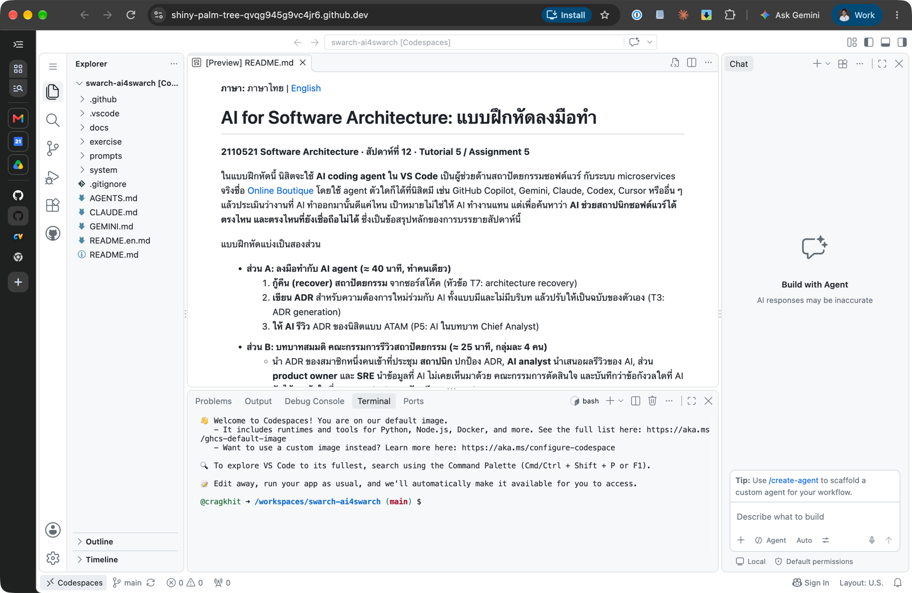
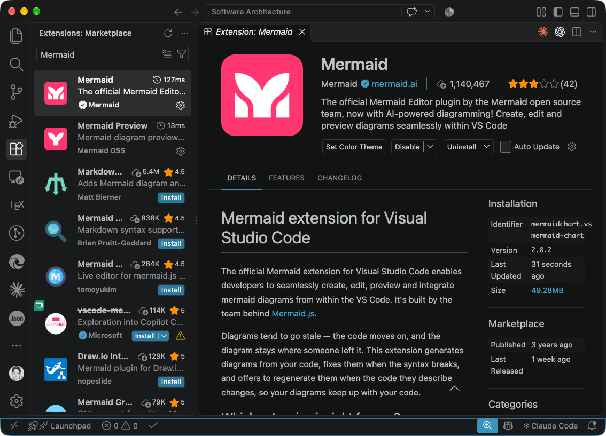

**Language:** [ภาษาไทย](README.md) | English

# AI for Software Architecture: Hands-on Exercise

**2110521 Software Architecture · Week 12 · Tutorial 5 / Assignment 5**

You'll use **an AI coding agent in VS Code** as an architecture assistant on a real microservices system, [Online Boutique](https://github.com/GoogleCloudPlatform/microservices-demo). Use whichever agent you have: GitHub Copilot, Gemini, Claude, Codex, Cursor or another. Then you'll judge how good its work is. The goal is not to get the AI to do the assignment. The goal is to find out **where AI helps an architect and where it can't be trusted**, which is the main finding of this week's lecture.

> ⚠️ **Don't open the original Online Boutique repository until you have finished Task 1.** Its README contains the official architecture diagram, which is exactly what you will recover and verify yourself. Everything you need is in this repository's `system/online-boutique/` folder. You may compare with the original diagram after you submit.

The exercise has two parts:

- **Part A: hands-on with an AI agent (approximately 40 min, individual)**
  1. **Recover** the architecture from the code (lecture topic T7: architecture recovery)
  2. **Write an ADR** for a new requirement with the AI, with and without context, then make it your own (T3: ADR generation)
  3. **Get the AI's review** of your ADR, ATAM-style (P5: AI as Chief Analyst)
- **Part B: architecture review board role-play (approximately 25 min, groups of 4)**
  - One group member's ADR goes to a review board. The **architect** defends it, the **AI analyst** presents the AI's review, and a **product owner** and an **SRE** bring knowledge the AI never saw. The board decides, and records which concerns the AI caught and which it missed (AICH4: *plausible ≠ appropriate*).

Expected time: about 75 minutes in class.

---

## Before class: set up (approximately 15 minutes, do it early)

1. **Install [VS Code](https://code.visualstudio.com/).** No local VS Code? Skip this step and use GitHub Codespaces instead (see step 3).
2. **Get an AI agent that can read and write files in your workspace.** Any of these works:

   | Agent | Where it runs in VS Code | Free option for students |
   |---|---|---|
   | **GitHub Copilot**, in **Agent** mode | Chat view | Copilot Student via [GitHub Education](https://docs.github.com/en/copilot/how-tos/copilot-on-github/set-up-copilot/enable-copilot/set-up-for-students) (approval can take days), or Copilot Free |
   | **Gemini Code Assist**, in agent mode | Gemini panel | Free tier with a personal Google account |
   | **Gemini CLI** | VS Code terminal | Free tier with a Google account |
   | **Claude Code**, **Codex**, **Cursor**, **Cline**, … | Extension, terminal or editor | Depends on the tool |

   Plain chat that can't open files won't work, because the agent must read the code and write its results to files.
3. **Fork this repository.**
   - Click **Fork** (top right of this page) → **Create fork**. Your fork is public, which you need for submission.
   - Clone your fork and open the folder in VS Code.
   - **No local VS Code?** On your fork, click **Code** → **Codespaces** → **Create codespace on main**. This opens VS Code in the browser with your fork already loaded, and GitHub Copilot Chat (Agent mode) is ready to use. Do the remaining steps inside the codespace. Personal GitHub accounts get free Codespaces hours each month; stop the codespace when you finish.

     
4. **Install the two recommended Mermaid extensions** when VS Code asks (or search for them in the Extensions view):
   - **Markdown Preview Mermaid Support** (`bierner.markdown-mermaid`): renders the diagrams in the Markdown preview
   - **Mermaid** by Mermaid (`MermaidChart.vscode-mermaid-chart`): the official Mermaid editor; previews and edits diagrams, and highlights syntax errors

     

5. **Check that your agent can see the rules.** Open a new chat or session and ask: *"What are the rules for AI agents in this repository?"* It should summarise [`AGENTS.md`](AGENTS.md). If it doesn't, start each task message with `Read AGENTS.md first.`

## How the exercise works with any agent

- **The rules are in [`AGENTS.md`](AGENTS.md).** Most agents read it automatically. Small pointer files load the same rules for tools that look elsewhere: `GEMINI.md` for Gemini, `CLAUDE.md` for Claude Code, `.github/copilot-instructions.md` for Copilot.
- **The tasks are plain Markdown files in [`prompts/`](prompts/).** The worksheets give you the exact message to send, for example:

  ```
  Follow prompts/1-recover-architecture.md
  run: A
  evidence: system/online-boutique/protos/demo.proto
  ```

- **The agent writes its result to `exercise/outputs/`.** You review that file, then accept the change. Reject or undo anything else it tries to change.
- **The agent must not** edit `system/`, `prompts/`, the example ADR or your worksheets, and must not run terminal commands. If it asks to run a command, decline.

Because everyone uses the same task files and rules, results from different agents can be compared.

**Never let your agent read `docs/review-board/`.** Those role cards are for Part B, and the point is that the AI didn't see them.

## Budget

Part A needs about **5 agent requests**. Part B needs none.

- Each agent request reads files and writes a result, so it uses more of your quota than a chat answer. **Reading less is cheaper.**
- **Start a new chat or session for every run.** Old conversations are sent again with each request.
- If your free quota runs out, you can switch to another agent mid-exercise. Note it in your prompt log.

## Rules of the game

- **Log every request** in [`exercise/00-prompt-log.en.md`](exercise/00-prompt-log.en.md): which agent and model, what you asked, which files the agent read, and whether it stayed within the evidence you allowed.
- **Check claims against the code.** A claim without a file path as evidence is a guess until you verify it.
- **Never paste AI output as your own conclusion** without marking it. The worksheets have separate places for *the AI's answer* and *your judgement*.

## The tasks

| Part | # | Worksheet | Task file | Agent requests | Time |
|---|---|---|---|---|---|
| A | 1 | [Recover the architecture](exercise/01-recover-architecture.en.md) | `prompts/1-recover-architecture.md` | 2 | 15 min |
| A | 2 | [Write an ADR for a new requirement](exercise/02-write-adr.en.md) | `prompts/2-write-adr.md` | 2 | 20 min |
| A | 3 | [Get the AI's review](exercise/03-ai-review.en.md) | `prompts/3-review-adr.md` | 1 | 5 min |
| B | 4 | [Architecture review board](exercise/04-review-board.en.md) | (role cards in `docs/review-board/`) | 0 | 25 min |
| | 5 | [Individual reflection](exercise/05-reflection.en.md) | | 0 | after class is fine |
| | ★ | [Bonus: recover an unwritten decision](exercise/bonus-recover-decision.en.md) | `prompts/bonus-recover-decision.md` | 1 | optional, take-home |

> Every worksheet has an English version (`*.en.md`) and a Thai version (`*.md`). **Fill in one language version only**; you may answer in Thai or English. Messages to the agent stay in English.

## Submission (Assignment 5, due by the end of class)

1. Fill in worksheets 00–05 in `exercise/` (one language version each), including your group's review-board record. Keep the agent's files in `exercise/outputs/`, and write your final ADR at `docs/adr/0002-*.md`.
2. Commit and push to your repository.
3. Submit the repository URL on MCV. Make sure the repository is public.

## What's in this repository

```
AGENTS.md                   rules for every AI agent (+ GEMINI.md, CLAUDE.md, .github/copilot-instructions.md pointers)
prompts/                    the task files you ask the agent to follow
docs/
  adr/template.md           the ADR format we use
  adr/0001-…                an example ADR (used in Task 2)
  scenario.md               business context for Task 2 (Thai: scenario.th.md)
  review-board/             role cards for Part B (humans only)
exercise/                   your worksheets (you edit these)
  outputs/                  files written by the AI agent
system/online-boutique/     the system you analyse (trimmed snapshot)
```

## Credits

The system under study is [Online Boutique](https://github.com/GoogleCloudPlatform/microservices-demo) by Google, used under the Apache License 2.0. See [`system/README.md`](system/README.md) for what was changed for this exercise.

The exercise design draws on Bucaioni et al., *AI Support for Software Architecture Practice: A Systematic Review and Future Directions*, ACM TOSEM 35(9), 2026.
