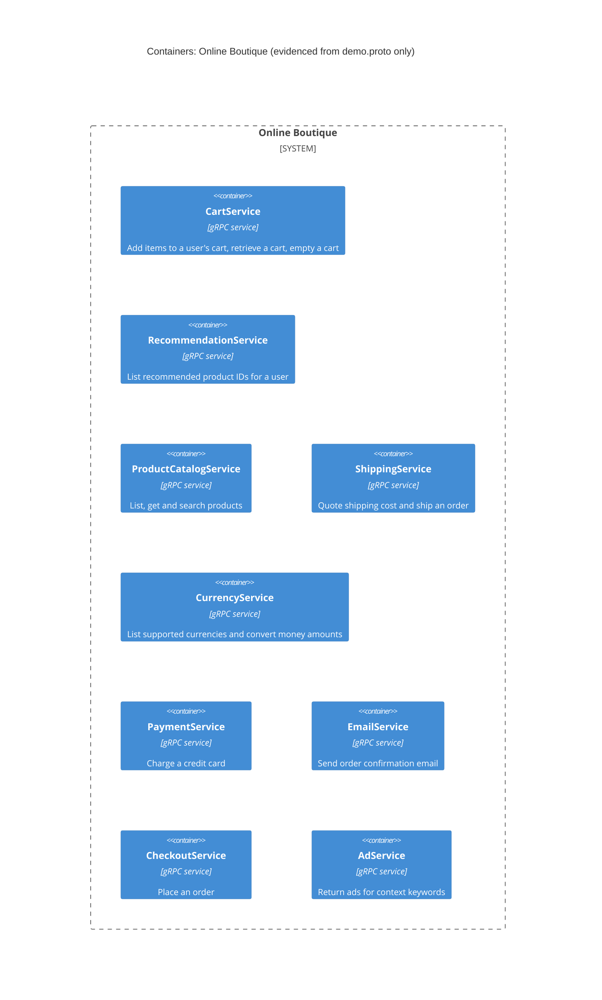

# 1A — Recovered architecture (run A)

## 1. Agent

Claude Code, model Claude Sonnet 5 (`claude-sonnet-5`).

## 2. Files read

- `system/online-boutique/protos/demo.proto`

## 3. Containers table

| Name | Technology / language | Responsibility | Evidence |
|---|---|---|---|
| CartService | gRPC service (Protocol Buffers) | Add items to a user's cart, retrieve a cart, empty a cart | `system/online-boutique/protos/demo.proto:23-27` |
| RecommendationService | gRPC service (Protocol Buffers) | List recommended product IDs for a user given a set of product IDs | `system/online-boutique/protos/demo.proto:56-58` |
| ProductCatalogService | gRPC service (Protocol Buffers) | List products, get a single product, search products | `system/online-boutique/protos/demo.proto:71-75` |
| ShippingService | gRPC service (Protocol Buffers) | Quote a shipping cost for an address/cart, ship an order and return a tracking ID | `system/online-boutique/protos/demo.proto:107-110` |
| CurrencyService | gRPC service (Protocol Buffers) | List supported currencies, convert a money amount between currencies | `system/online-boutique/protos/demo.proto:140-143` |
| PaymentService | gRPC service (Protocol Buffers) | Charge a credit card for an amount and return a transaction ID | `system/online-boutique/protos/demo.proto:177-179` |
| EmailService | gRPC service (Protocol Buffers) | Send an order confirmation email | `system/online-boutique/protos/demo.proto:199-201` |
| CheckoutService | gRPC service (Protocol Buffers) | Place an order (takes user, address, email, credit card) and return the order result | `system/online-boutique/protos/demo.proto:224-226` |
| AdService | gRPC service (Protocol Buffers) | Return ads for a set of context keywords | `system/online-boutique/protos/demo.proto:243-245` |

The `go_package` option (`demo.proto:19`) only names the Go package for generated stubs shared by all nine services; it does not evidence the implementation language of any individual service. No data store or message-broker container is declared in this file.

## 4. Dependencies table

Not evidenced in the provided files.

`demo.proto` declares each service's RPC methods and message shapes, but a `.proto` file only describes an interface — it does not record which service acts as a client and calls which other service at runtime. Several messages reuse types across services (e.g. `ShippingService.GetQuoteRequest` and `CartService.AddItemRequest` both use `CartItem`; `EmailService.SendOrderConfirmationRequest` wraps an `OrderResult` built from `Address`, `Money`, and `OrderItem`/`CartItem`), and `CheckoutService.PlaceOrderRequest` carries an `Address` and `CreditCardInfo`. These shared message shapes make it **[Inferred]** that CheckoutService calls PaymentService, ShippingService, EmailService, CurrencyService, CartService and/or ProductCatalogService, but this file gives no evidence of an actual call (no client stub usage, no import of one service's client by another). No dependency is listed in the table below the line, per task instructions.

## 5. Mermaid diagram

No `Person`, `System_Ext`, `ContainerDb`, `ContainerQueue` or `Rel` is included: none is evidenced in `demo.proto` (see Gaps).

## 6. Gaps

| Gap | Extra file that would settle it |
|---|---|
| Who calls whom at runtime (caller → callee relationships) | Service source code (e.g. `system/online-boutique/src/checkoutservice/`) showing gRPC client calls, or `system/online-boutique/kubernetes-manifests/*.yaml` showing `*_SERVICE_ADDR` environment variables |
| Implementation language/technology per service | Each service's source folder under `system/online-boutique/src/` (e.g. `go.mod`, `package.json`, `requirements.txt`) |
| Whether an end user (`Person`) or a frontend container exists | `system/online-boutique/src/frontend/` and its entry in `kubernetes-manifests/` |
| Any data store (e.g. for cart persistence) | `system/online-boutique/src/cartservice/` source and its Kubernetes manifest (look for a Redis/db dependency) |
| Any message broker | `system/online-boutique/kubernetes-manifests/` and relevant service source (e.g. checkout/shipping) |
| Any external system (payment gateway, email provider) | `system/online-boutique/src/paymentservice/` and `system/online-boutique/src/emailservice/` source |
