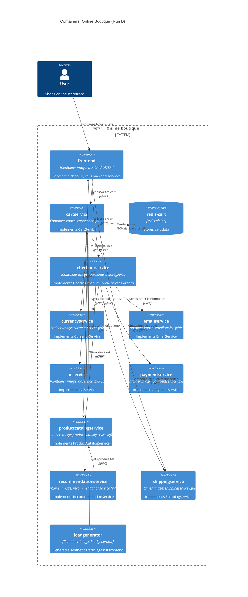

# Recovered architecture — Run B

## 1. Agent

Claude Code, model Sonnet 5 (`claude-sonnet-5`).

## 2. Files read

- `system/online-boutique/protos/demo.proto`
- `system/online-boutique/kubernetes-manifests/README.md`
- `system/online-boutique/kubernetes-manifests/kustomization.yaml`
- `system/online-boutique/kubernetes-manifests/frontend.yaml`
- `system/online-boutique/kubernetes-manifests/cartservice.yaml`
- `system/online-boutique/kubernetes-manifests/checkoutservice.yaml`
- `system/online-boutique/kubernetes-manifests/currencyservice.yaml`
- `system/online-boutique/kubernetes-manifests/emailservice.yaml`
- `system/online-boutique/kubernetes-manifests/adservice.yaml`
- `system/online-boutique/kubernetes-manifests/paymentservice.yaml`
- `system/online-boutique/kubernetes-manifests/productcatalogservice.yaml`
- `system/online-boutique/kubernetes-manifests/recommendationservice.yaml`
- `system/online-boutique/kubernetes-manifests/shippingservice.yaml`
- `system/online-boutique/kubernetes-manifests/loadgenerator.yaml`

## 3. Containers table

| Name | Technology | Responsibility | Evidence |
|---|---|---|---|
| frontend | Container image `frontend`; HTTP server on port 8080 (HTTP readiness/liveness probes) | Serves the shop UI and fans out to the backend gRPC services | `frontend.yaml` (image/port L39-49, httpGet probes L50-65, Service L108-121, Service `frontend-external` L123-136) |
| cartservice | Container image `cartservice`; gRPC server on port 7070 | Implements `CartService` (add/get/empty cart) | `cartservice.yaml` (image/port L38-48, grpc probes L59-67); `demo.proto` (`service CartService` L23-27) |
| redis-cart | Container image `redis:alpine`; TCP on port 6379 | Backing store for cart data | `cartservice.yaml` (image/port L109-120, tcpSocket probes L121-128, Service L143-157) |
| checkoutservice | Container image `checkoutservice`; gRPC server on port 5050 | Implements `CheckoutService.PlaceOrder`, orchestrates the order flow | `checkoutservice.yaml` (image/port L37-47, grpc probes L48-53); `demo.proto` (`service CheckoutService` L224-226) |
| currencyservice | Container image `currencyservice`; gRPC server on port 7000 | Implements `CurrencyService` (list/convert currencies) | `currencyservice.yaml` (image/port L37-49, grpc probes L55-60); `demo.proto` (`service CurrencyService` L140-143) |
| emailservice | Container image `emailservice`; gRPC server on container port 8080, exposed as Service port 5000 | Implements `EmailService.SendOrderConfirmation` | `emailservice.yaml` (image/port L37-48, grpc probes L54-61, Service L70-83); `demo.proto` (`service EmailService` L199-201) |
| adservice | Container image `adservice`; gRPC server on port 9555 | Implements `AdService.GetAds` | `adservice.yaml` (image/port L37-48, grpc probes L59-68); `demo.proto` (`service AdService` L243-245) |
| paymentservice | Container image `paymentservice`; gRPC server on port 50051 | Implements `PaymentService.Charge` | `paymentservice.yaml` (image/port L37-48, grpc probes L54-59); `demo.proto` (`service PaymentService` L177-179) |
| productcatalogservice | Container image `productcatalogservice`; gRPC server on port 3550 | Implements `ProductCatalogService` (list/get/search products) | `productcatalogservice.yaml` (image/port L37-48, grpc probes L54-59); `demo.proto` (`service ProductCatalogService` L71-75) |
| recommendationservice | Container image `recommendationservice`; gRPC server on port 8080 | Implements `RecommendationService.ListRecommendations` | `recommendationservice.yaml` (image/port L37-48, grpc probes L49-56); `demo.proto` (`service RecommendationService` L56-58) |
| shippingservice | Container image `shippingservice`; gRPC server on port 50051 | Implements `ShippingService` (quote/ship order) | `shippingservice.yaml` (image/port L36-47, grpc probes L53-59); `demo.proto` (`service ShippingService` L107-110) |
| loadgenerator | Container image `loadgenerator` | Generates synthetic traffic against the `frontend` Service | `loadgenerator.yaml` (image/env L80-87, init container frontend-reachability check L40-70) |

## 4. Dependencies table

| Caller → Callee | Protocol | Evidence |
|---|---|---|
| User → frontend | HTTP | `frontend.yaml` Service `frontend-external`, type LoadBalancer, port 80→8080 (L123-136); httpGet readiness/liveness probes (L50-65) |
| loadgenerator → frontend | HTTP | `loadgenerator.yaml` env `FRONTEND_ADDR=frontend:80` (L69-70, L82-83); init-container `wget http://${FRONTEND_ADDR}` (L49) |
| frontend → productcatalogservice | gRPC | `frontend.yaml` env `PRODUCT_CATALOG_SERVICE_ADDR=productcatalogservice:3550` (L69-70); `demo.proto` `service ProductCatalogService` (L71-75) |
| frontend → currencyservice | gRPC | `frontend.yaml` env `CURRENCY_SERVICE_ADDR=currencyservice:7000` (L71-72); `demo.proto` `service CurrencyService` (L140-143) |
| frontend → cartservice | gRPC | `frontend.yaml` env `CART_SERVICE_ADDR=cartservice:7070` (L73-74); `demo.proto` `service CartService` (L23-27) |
| frontend → recommendationservice | gRPC | `frontend.yaml` env `RECOMMENDATION_SERVICE_ADDR=recommendationservice:8080` (L75-76); `demo.proto` `service RecommendationService` (L56-58) |
| frontend → shippingservice | gRPC | `frontend.yaml` env `SHIPPING_SERVICE_ADDR=shippingservice:50051` (L77-78); `demo.proto` `service ShippingService` (L107-110) |
| frontend → checkoutservice | gRPC | `frontend.yaml` env `CHECKOUT_SERVICE_ADDR=checkoutservice:5050` (L79-80); `demo.proto` `service CheckoutService` (L224-226) |
| frontend → adservice | gRPC | `frontend.yaml` env `AD_SERVICE_ADDR=adservice:9555` (L81-82); `demo.proto` `service AdService` (L243-245) |
| cartservice → redis-cart | TCP (Redis protocol) | `cartservice.yaml` env `REDIS_ADDR=redis-cart:6379` (L50-51); redis-cart tcpSocket probes (L121-128) |
| checkoutservice → productcatalogservice | gRPC | `checkoutservice.yaml` env `PRODUCT_CATALOG_SERVICE_ADDR=productcatalogservice:3550` (L57-58); `demo.proto` `service ProductCatalogService` (L71-75) |
| checkoutservice → shippingservice | gRPC | `checkoutservice.yaml` env `SHIPPING_SERVICE_ADDR=shippingservice:50051` (L59-60); `demo.proto` `service ShippingService` (L107-110) |
| checkoutservice → paymentservice | gRPC | `checkoutservice.yaml` env `PAYMENT_SERVICE_ADDR=paymentservice:50051` (L61-62); `demo.proto` `service PaymentService` (L177-179) |
| checkoutservice → emailservice | gRPC | `checkoutservice.yaml` env `EMAIL_SERVICE_ADDR=emailservice:5000` (L63-64); `demo.proto` `service EmailService` (L199-201) |
| checkoutservice → currencyservice | gRPC | `checkoutservice.yaml` env `CURRENCY_SERVICE_ADDR=currencyservice:7000` (L65-66); `demo.proto` `service CurrencyService` (L140-143) |
| checkoutservice → cartservice | gRPC | `checkoutservice.yaml` env `CART_SERVICE_ADDR=cartservice:7070` (L67-68); `demo.proto` `service CartService` (L23-27) |
| recommendationservice → productcatalogservice | gRPC | `recommendationservice.yaml` env `PRODUCT_CATALOG_SERVICE_ADDR=productcatalogservice:3550` (L60-61); `demo.proto` `service ProductCatalogService` (L71-75) |

## 5. Mermaid diagram

## 6. Gaps

- **Programming languages of each service.** The manifests only show container image names (e.g. `cartservice`, `checkoutservice`) and `demo.proto` only defines the gRPC interfaces — neither states the implementation language. Settling this needs each service's `Dockerfile` or source directory under `system/online-boutique/src/`.
- **`shoppingassistantservice`.** `frontend.yaml` defines `SHOPPING_ASSISTANT_SERVICE_ADDR=shoppingassistantservice:80` (L83-84), implying a dependency, but no `shoppingassistantservice.yaml` exists in `kubernetes-manifests/`. Not evidenced in the provided files — a manifest or Kustomize component for this service would settle it. (The commented-out line in `kustomization.yaml` referencing `../kustomize/components/shopping-assistant` is consistent with this being an optional/disabled component, but that path wasn't read.)
- **loadgenerator's production status.** `kustomization.yaml` (L24) explicitly comments out `loadgenerator.yaml` from the resource list, noting Skaffold's own loadgenerator module is used "during development" instead. It's unclear from the given evidence whether `loadgenerator` is part of the deployed production system or a dev/test-only harness; `skaffold.yaml` would settle it.
- **Exact wire protocol for frontend↔backend calls.** No manifest field states "gRPC" directly for these links; the gRPC classification rests on inference from `demo.proto` service definitions plus the `grpc:` readiness/liveness probe type used by each backend service (e.g. `cartservice.yaml` L61-62). This is strong but indirect evidence — the generated client/server stub code (not read, out of scope) would confirm it directly.
- **Whether `frontend` itself has further dependencies not in env vars** (e.g. config files, service mesh/Istio behavior). `frontend.yaml` has an `istio` sidecar-rewrite annotation (L30) but no Istio manifest was in scope, so any Istio-mediated routing is not evidenced here.
